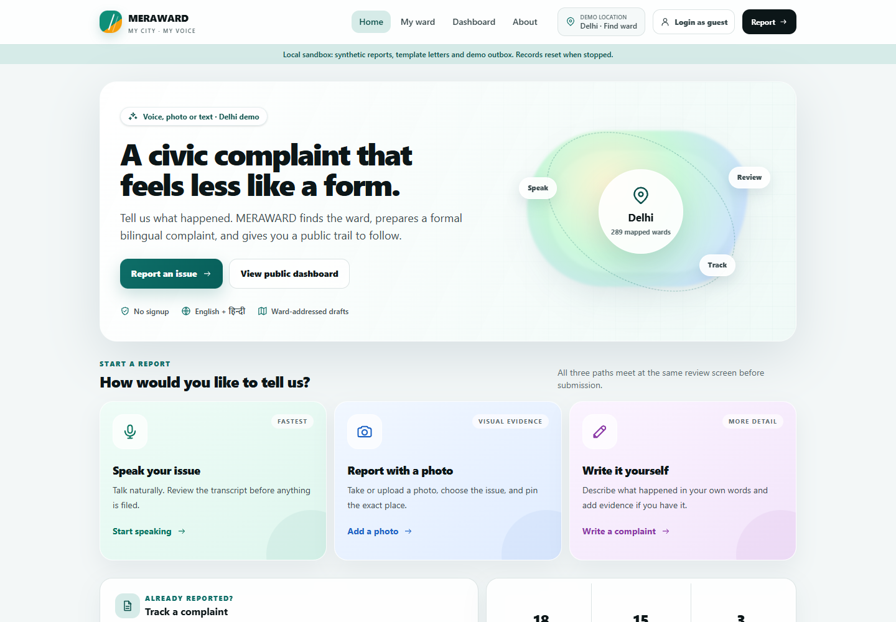
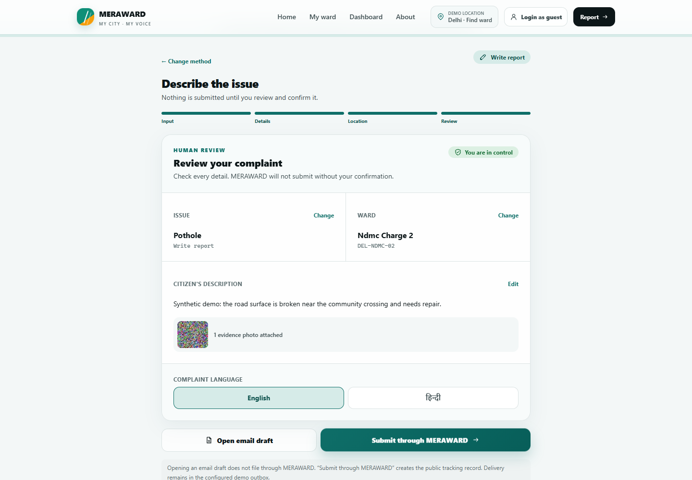
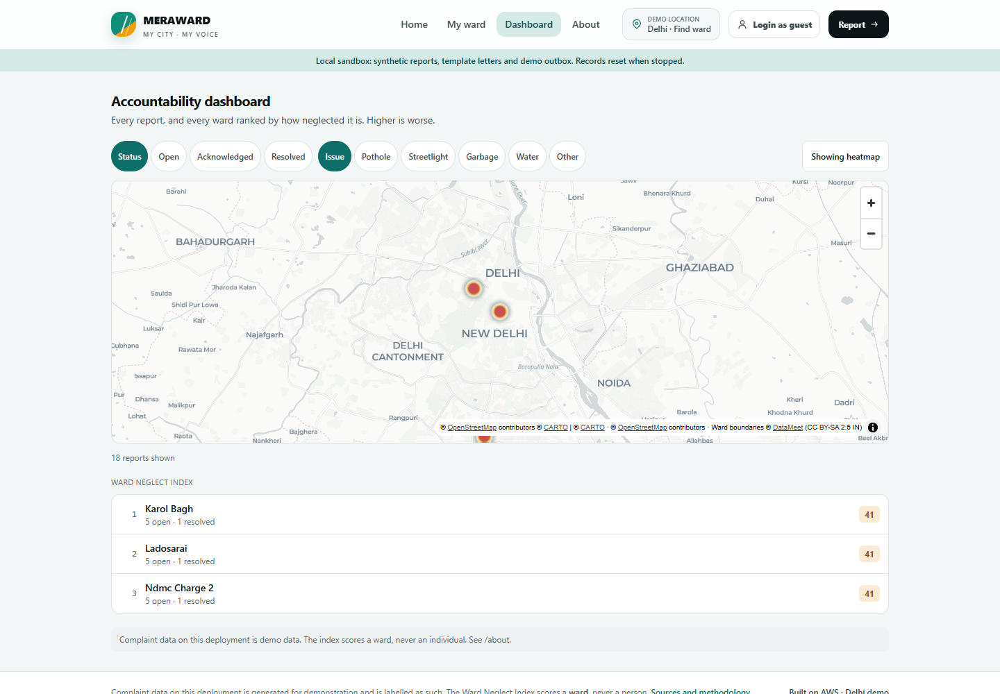
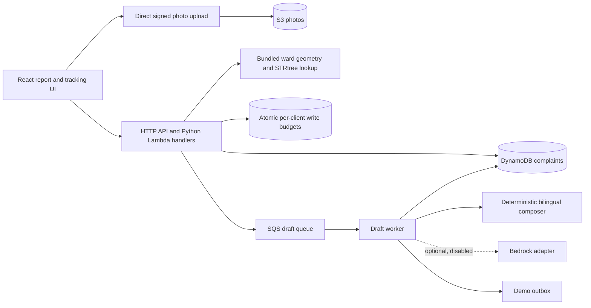

<div align="center">


# MERAWARD

### Find your ward. Prepare a complaint. Follow what happens.

A civic-reporting demo that turns a spoken, photographed or written account into a reviewed complaint, a formal letter in English and Hindi, and a public tracking record.

[](https://github.com/amritkang165/meraward/actions/workflows/verify.yml)
[](LICENSE)

[Run locally](#run-the-local-demo) · [Report workflow](#from-a-problem-to-a-public-record) · [Architecture](#behind-the-screen) · [Developer guides](#developer-guides)

</div>



*Actual local app, using synthetic reports. The bundled Delhi boundaries are the earlier, pre-2022 dataset. Delivery stays in the demo outbox; the app does not email real officials.*

## From a problem to a public record

Knowing where to report is often the first obstacle. MeraWard connects a location with its ward, helps prepare the complaint, and keeps a visible status trail instead of ending at a submitted form.

| Tell us | Review it | Track it |
| --- | --- | --- |
| Speak in a supported browser, attach a photo, or type what happened. Typed input is available when speech capture is unsupported. | Choose the issue, confirm the location and ward, then review before submission. | Read the English/Hindi draft and use your private update link to acknowledge, resolve or reopen the report. |

**Drafting works without model access.** The default is a deterministic bilingual template, with the reporter's original words quoted unchanged. Bedrock is an optional adapter and remains disabled. A Hindi letter does not imply that an English description has been translated.



## Run the local demo

Install Docker, then from a checkout of this repository:

```bash
docker compose up --build
```

Open **http://localhost:5174**. Choose **Write a complaint**, describe a synthetic issue, select **Pothole**, confirm the details and use the default Delhi pin or your location. Select **Review complaint**, then **Submit through MERAWARD**. The letter appears after the local queue worker finishes.

Use **Track this complaint** to read it. Keep **Your private update link** to change its status; the public tracking URL intentionally does not grant that permission. Optional guest profiles only remember reports on this device and are not server authentication.

The sandbox starts with 18 synthetic reports across three wards resolved from the bundled geometry. Every new local report is also marked as a demo record. It runs the actual Python handlers, composer and geometry against temporary Moto DynamoDB/S3/SQS services. **No AWS account, Bedrock key or email configuration is required.** Map tiles still need an internet connection.

| Local endpoint | Purpose |
| --- | --- |
| `http://localhost:5174` | React app; use this origin for browser CORS |
| `http://localhost:8101/health` | API mode, geometry and write-budget status |
| `http://localhost:5001` | Local AWS emulator, including direct photo transfers |

Compose binds these ports to loopback. Records and uploads are **temporary in-memory data**: stopping/recreating the API resets them. This is an isolated development sandbox, not a durable deployment. Stop with `docker compose down`.

<details>
<summary><strong>Fast frontend edits and native development</strong></summary>

The Docker frontend mounts `frontend/src/` and `frontend/public/` read-only and enables polling for Windows bind mounts. Source edits refresh through Vite without rebuilding the image. Rebuild when dependencies or Vite configuration change. Backend changes need `docker compose up -d --build api`, which resets the sandbox.

For native development, use **Python 3.13** in a virtual environment and **Node.js 22.12+ or 24**. From the root:

```bash
python -m pip install -r backend/requirements-demo.txt
python backend/local_demo.py
```

In another terminal, from `frontend/`, install the locked dependencies with `npm ci`. Put these local, non-secret settings in `frontend/.env.local`:

```dotenv
VITE_API_BASE_URL=http://localhost:8101
VITE_LOCAL_DEMO=true
```

Then run:

```bash
npm run dev -- --port 5174 --strictPort
```

Use either the complete Compose stack or the native setup so they do not compete for the same ports. The runner replaces inherited AWS profiles, credentials, endpoints and delivery settings before importing the handlers. It does not read real `.env` files or AWS credential files.

</details>

## See the wider picture



The dashboard combines complaint markers/heatmap and a **Ward Neglect Index**. A ward with fewer than five reports is unranked, not scored zero. The index describes the ward's report history, never a named individual; synthetic data is not evidence of real service quality. The [methodology](backend/src/common/index.py) and [data provenance](CREDITS.md) explain the inputs and limits.

## Behind the screen



On AWS, API Gateway, Lambda, DynamoDB, S3 and SQS supply those services; an hourly job recomputes ward statistics. Locally, Moto emulates the AWS services and the runner dispatches HTTP requests to the same handlers. It also recomputes local statistics after drafts and status changes so a demonstration does not need to wait an hour. Emulation does not prove AWS IAM, S3 signature enforcement or delivery behavior on a deployed stack.

Status changes use a private capability token and a conditional database update. Reads pass through a public-field allowlist that excludes status tokens and reporter email. A shareable complaint includes its location, description and photo: use synthetic evidence when trying the demo.

## Developer guides

| Need | Guide |
| --- | --- |
| Backend handlers, tests and storage contract | [Backend README](backend/README.md) |
| Frontend routes, map worker and PWA behavior | [Frontend README](frontend/README.md) |
| Write budgets, CORS, dependency limits and verification | [Maintenance notes](docs/MAINTENANCE.md) |
| Shared-stack deployment procedure | [AWS setup](docs/AWS_SETUP.md) |
| Architectural choices and event history | [Decision log](docs/DECISIONS.md), [original submission](docs/SUBMISSION.md), [learning notes](LEARNING.md) |
| Dataset sources and remaining limits | [Credits](CREDITS.md), [known issues](KNOWN_ISSUES.md) |

<details>
<summary><strong>Run the checks</strong></summary>

In the configured Python environment, from the root:

```bash
python -m pip install -r backend/requirements-dev.txt
python -m pytest backend -q
sam validate --lint --template-file backend/template.yaml --region ap-south-1
```

From `frontend/`:

```bash
npm ci
npm run build
npm audit --omit=dev
```

With the local stack running, from the root:

```bash
python backend/tests/smoke_demo.py
```

That smoke test refuses non-loopback URLs. It verifies ward lookup, a real synthetic PNG upload/download, a queued template draft, public/private fields, invalid-token rejection, resolve and reopen. CI runs backend tests, frontend build/production audit, SAM lint and the Docker HTTP smoke without AWS credentials. The full development audit still reports Workbox build-tool advisories; see the maintenance notes.

</details>

## Deployment and scope

The [original hosted demo](https://main.d1s6q0cvldi6dz.amplifyapp.com) and its [health endpoint](https://9f41c4bkel.execute-api.ap-south-1.amazonaws.com/health) responded on **2026-10-31**, with 289 boundaries loaded, template drafting and `DEMO_OUTBOX`. Maintenance-branch changes need review, merge and a separate shared-stack deployment; a green build is not evidence that they are live.

The ward polygons are historical, and councillor matches have the limitations recorded in [CREDITS.md](CREDITS.md). They were not updated by this work. The app has no server login; a guest alias is not an authenticated identity. Per-source write budgets provide basic abuse control rather than bot protection. Sending to real officials remains refused in code. Old timings and Lighthouse results in event-era notes are historical measurements, not guarantees for the patched build.

## Team and contribution

Built by **Sleepy peeps (`4T5AKB`)** for **First Commit · Bharat Builds Tour** (WeMakeDevs × AWS Builder Center), Ship It track.

| Contributor | Work |
| --- | --- |
| [Amrit Kang](https://github.com/amritkang165) | Team lead, frontend, ward data and submission |
| [Kartik Dixit](https://github.com/Kartikdixit2468) | AWS infrastructure, original deployment work and complaint-intake improvements |
| [Muneer Alam](https://github.com/Muneer320) | Backend handlers, geospatial lookup, index, SAM integration and verification |

The SAM and deployment work spans Kartik and Muneer; it is not claimed as a solo project. Original event documentation discloses Claude/Claude Code assistance; Bedrock is an optional runtime integration, not a claim that every letter used a model.

Report reproducible problems in [Issues](https://github.com/amritkang165/meraward/issues), using synthetic inputs and no private update links. Changes go through pull requests to this team repository. Preserve the public-field boundary and add regression coverage for write, token or index changes.

Application code: [MIT](LICENSE). Ward boundary data: © DataMeet contributors, **CC BY-SA 2.5 IN**; map/data attribution is retained in the interface and [credits](CREDITS.md).
